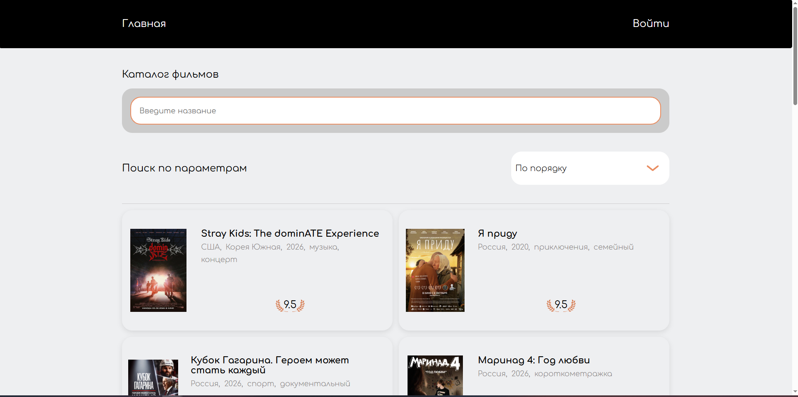
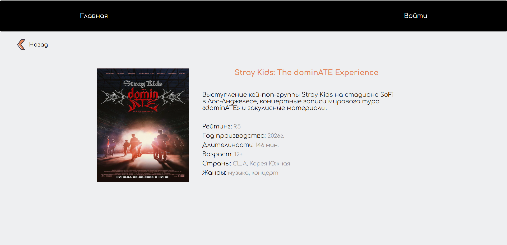

# FilmFinds

Веб-приложение для поиска фильмов: каталог с поиском и сортировкой, детальная страница фильма и личный список избранного. Данные о фильмах приходят из API Кинопоиска, пользователи и их избранное хранятся в Strapi.




## Стек

- **Фронтенд:** Vue 3, Vuex, Vue Router, Axios, SCSS, Swiper, Vite, ESLint
- **Бэкенд:** Strapi (регистрация, авторизация, хранение избранного)
- **Внешний API:** Kinopoisk API Unofficial

## Возможности

- Каталог фильмов с пагинацией
- Поиск по названию и сортировка
- Детальная страница фильма: рейтинг Кинопоиска, год, длительность, страны, возрастное ограничение, кадры из фильма
- Слайдер на главной (Swiper)
- Регистрация и вход
- Добавление фильмов в избранное, список сохраняется в профиле пользователя
- Собственная директива закрытия по клику вне элемента

## Структура

```
my-strapi-project/   — бэкенд на Strapi
vue-cinema/          — фронтенд на Vue 3
```

## Запуск

**1. Бэкенд**

```bash
cd my-strapi-project
cp .env.example .env
npm install
npm run develop
```

**2. Фронтенд**

Получите бесплатный ключ на [kinopoiskapiunofficial.tech](https://kinopoiskapiunofficial.tech), затем:

```bash
cd vue-cinema
cp .env.example .env   # и впишите ключ в .env
npm install
npm run dev
```
